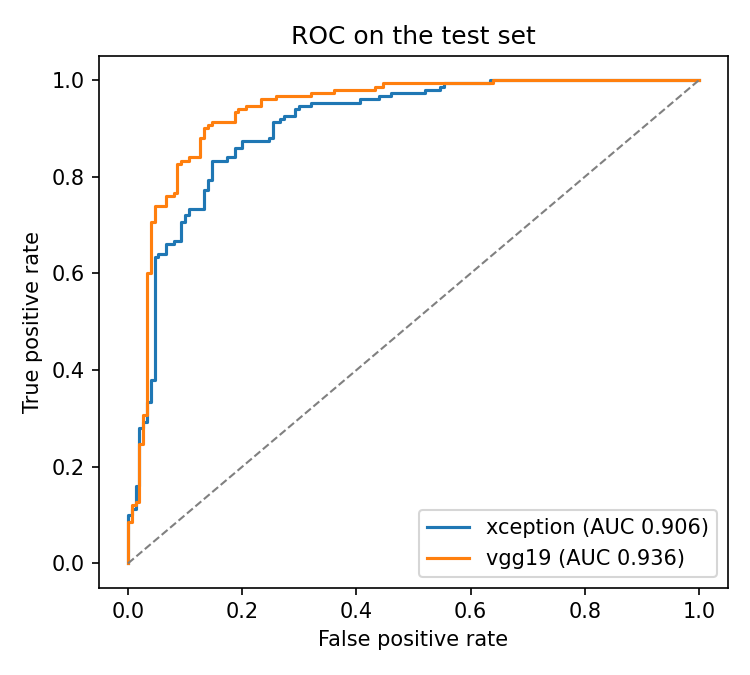
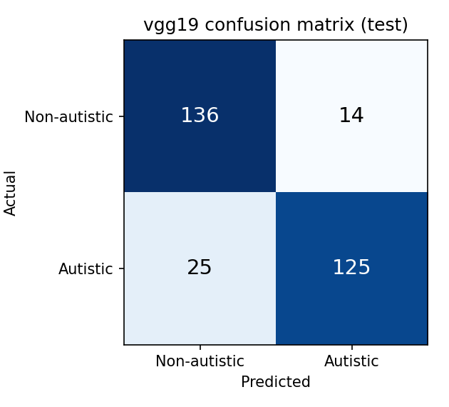
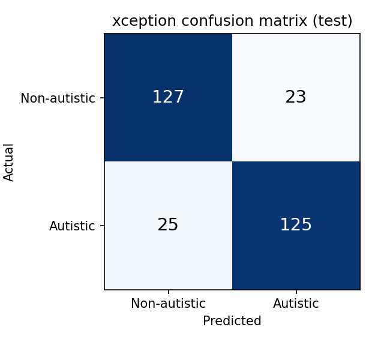

# Autix

Compare two transfer-learning CNNs, **Xception** and **VGG19**, on a face photo, with class activation maps that show what each model looked at. Both models run entirely in the browser with TensorFlow.js, so photos never leave the visitor's device.

**Live demo:** _add your Azure link here_

> **Educational project, not a diagnostic tool.** Autism is diagnosed through behavioural assessment by qualified clinicians and cannot be identified from a photo. This project shows what CNNs learn from a public, web-collected dataset, and where that goes wrong.

## Results

Both models are evaluated on the same held-out test set (150 autistic + 150 non-autistic images, threshold 0.5).

| Model | Accuracy | Precision | Recall | F1 | AUC |
|---|---|---|---|---|---|
| VGG19 | **87.0%** | 89.9% | 83.3% | 86.5% | **0.936** |
| Xception | 84.0% | 84.5% | 83.3% | 83.9% | 0.906 |

Trained 2026-10-13 with TensorFlow 2.21, seed 42. Each model is about 40 MB in the browser (float16).

<p align="center">
  
</p>

| VGG19 confusion matrix | Xception confusion matrix |
|---|---|
|  |  |

Training curves: [VGG19](assets/figures/vgg19_training.png), [Xception](assets/figures/xception_training.png). The dashed line marks the switch from training the head to fine-tuning the top blocks.

The 2022 version of this project reported 86% accuracy for Xception. That run had evaluation bugs and no fixed seed, so the numbers above come from a clean retrain. With 300 test images, a gap of 3 points between the two models is within noise (roughly ±4 points at 95% confidence).

## How it works

1. **Data:** [Kaggle autism image data](https://www.kaggle.com/datasets/cihan063/autism-image-data): 2,540 training, 100 validation and 300 test face images, balanced between classes. A hash check confirms no image appears in two splits.
2. **Models:** ImageNet-pretrained Xception and VGG19 with their own preprocessing built into the model, followed by `GlobalAveragePooling → Dropout → Dense(1, sigmoid)`.
3. **Training:** stage 1 trains the head with augmentation and early stopping (best weights restored); stage 2 fine-tunes the top blocks at a low learning rate. Seeds are fixed.
4. **Explainability:** with a global-average-pooling head, the classifier's weights applied to the last feature map give an exact class activation map (CAM).
5. **Export:** each model is exported as a TensorFlow SavedModel, checked against Keras, and converted to a float16 TensorFlow.js graph model (about 40 MB each).
6. **Website:** React + Vite. MediaPipe finds and crops the face, both models run with TensorFlow.js (WebGL), and the CAM is drawn over the face.

## Repository layout

```
training/autix_train.ipynb   # Colab notebook: data, training, evaluation, export
web/                         # React site (Vite), deployed to Azure Static Web Apps
  src/lib/                   # model loading, face crop, heatmap
  public/models/             # exported TensorFlow.js models + metrics.json
assets/figures/              # evaluation figures from the notebook
.github/workflows/deploy.yml # builds the site and deploys it on every push to main
```

## Run it locally

```bash
cd web
npm install
npm run dev        # http://localhost:5173
```

The site needs the trained models in `web/public/models/`. See [NEXT_STEPS.md](NEXT_STEPS.md) to train and export them.

## Limitations

- The dataset was collected from the web. Labels are not clinically verified, and photo source, quality and age differ between classes.
- Models trained on such data can learn those cues instead of anything related to autism. The CAM heatmaps help show when that happens.
- The test set is small (300 images), so differences of a few points between the models are within noise.

## Original 2022 notebooks

The first version of this project is kept in [`legacy/`](legacy/) for reference. The current, reproducible training code is [`training/autix_train.ipynb`](training/autix_train.ipynb).
